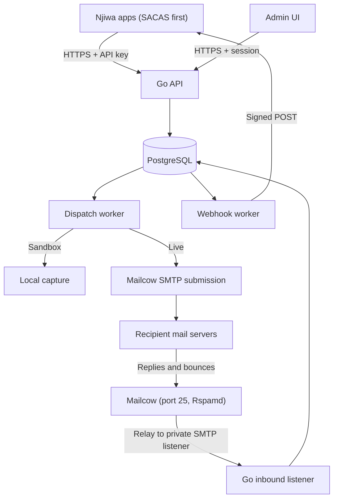

# Njiwa Mail — Full Implementation Plan (Go backend + UI)

Date: 11 November 2026
Goal: our own internal email platform — outbound sending, inbound receiving, bounces, webhooks and an admin UI — running on our existing Mailcow, with no paid provider.
First integration: SACAS (Go/Gin backend).
Status: specification only. The Go backend is partly built; this plan has not been checked against that code yet (see Phase 0).

---

## 1. What we are building

One internal service that every Njiwa app calls for email.

| Capability | In this plan | Notes |
|---|---|---|
| Send API with scoped API keys | Yes | Core |
| Durable queue, retries, idempotency | Yes | PostgreSQL is the queue |
| Sandbox capture | Yes | No external delivery |
| Templates in English and Kiswahili | Yes | Versioned, stored in the database |
| Inbound email parsed to JSON | Yes | Section 5.3 |
| Bounce processing and automatic suppression | Yes | Section 5.4 |
| Complaint (spam report) processing and suppression | Yes | Section 5.4 |
| Fair queueing between projects | Yes | One app's burst cannot delay another app's OTPs |
| Framework integration guides | Yes | Laravel, Django, Go, Node |
| Idempotency at every layer | Yes | Section 5.1.1 |
| Safe retry with failure classification | Yes | Section 5.1.2 |
| Connection pooling (database, SMTP, webhooks) | Yes | Section 5.1.3 |
| Raw sends, attachments, cc/bcc, batch and scheduled sends | Yes | Section 5.10 |
| SMTP ingress for apps that only speak SMTP | Yes | Section 5.10 |
| Multi-domain onboarding with verification | Yes | Section 5.11 |
| Two-factor login for admins | Yes | Section 5.7 |
| Analytics and operator alerts | Yes | Section 5.13 |
| Go and TypeScript clients, CLI | Yes | Section 5.14 |
| Signed webhooks with retries and replay | Yes | Section 5.5 |
| DNS health check (SPF, DKIM, DMARC, MX, PTR) | Yes | The service checks records; the operator publishes them |
| Admin UI | Yes | Built on the frontend template already in the repo |
| Wallet, billing, public signup | No | We are the only customer |
| SMS on receive, AI auto-reply | No | Not needed for internal use |
| Marketing or bulk campaigns, open and click tracking | No | Transactional only; protects IP reputation |

Rules that are not negotiable:

- Never report a status we cannot prove. `submitted` means Mailcow accepted the message, nothing more. `delivered` is never shown; the strongest positive state is `submitted` with no bounce received.
- Never auto-retry when acceptance is uncertain. Use `unknown` and let an operator reconcile.
- Never log or return OTPs, reset tokens, message bodies, API keys or SMTP passwords.
- Never read or write Mailcow's internal database.
- Every query is scoped by project AND environment.

---

## 2. Architecture

| Area | Decision | Reason |
|---|---|---|
| Language | Go, single binary with roles: `api`, `worker`, `inbound`, `scheduler` | Matches the code already written and the SACAS stack |
| HTTP router | Keep whatever the existing code uses | No rewrite for taste |
| Database | PostgreSQL via `pgxpool`; SQL migrations | Durable queue with `FOR UPDATE SKIP LOCKED` |
| Queue | Database tables, no Redis or broker | No dual-write problem |
| Outbound | SMTP submission to Mailcow over verified TLS | Mailcow does DKIM signing and onward retries |
| Inbound | Mailcow relays a dedicated subdomain to a private Go SMTP listener | Mailcow keeps port 25, TLS and spam filtering |
| Inbound fallback | IMAP polling of a catch-all mailbox | Use only if relay routing cannot be configured |
| Bounces | Parse DSN emails that return to our bounce address | Needs no access to Postfix logs |
| Templates | Go `html/template` and `text/template`, stored in DB with immutable versions | Auto-escaping; no user code execution |
| Admin auth | Email + password (argon2id), server-side sessions, roles | Simple and auditable |
| Frontend | The template already added to the repo | Do not change the UI kit |
| Deployment | Own Compose project, separate from Mailcow | Isolation |

Mail domains (replace with the real ones during setup):

- `notify.<domain>` — sending domain for outbound mail.
- `bounces@notify.<domain>` — envelope sender; DSNs come back here.
- `in.<domain>` — inbound subdomain; every address under it is routed to the Go listener.

If DNS is managed on Cloudflare, every mail hostname (MX target, SMTP host) must be DNS-only, not proxied. Cloudflare's proxy does not carry SMTP.

---

## 3. Phase 0 — Audit what already exists (do this first)

The backend is about half built. Before writing new code, compare the repository against this table and record each row as **Done**, **Partial** or **Missing** in `docs/AUDIT.md`. Fix Partial items before starting new modules.

| Item | What "Done" means |
|---|---|
| Projects and environments | Tables exist; sandbox/live mode; queries scoped |
| API keys | Prefix + hash stored; scopes; expiry; revocation; secret shown once |
| `POST /v1/emails` | Returns 202 only after commit; validation complete |
| Idempotency | Unique on `(project, environment, key)`; HMAC payload comparison; 409 on mismatch |
| Dispatch worker | `SKIP LOCKED` claim, lease token, claim committed before SMTP |
| State machine | All states in section 5 implemented, including `unknown` |
| SMTP transport | TLS verified; finite timeouts; failure classification |
| Sandbox transport | Captures locally; never dials SMTP |
| Rate limits | Per project and per recipient; atomic under concurrency |
| Suppressions | Checked at accept time |
| Payload encryption | Encrypted at rest; cleared on terminal state |
| Tests | Exist and pass for the above |

---

## 4. Database schema

Existing tables (confirm in Phase 0): `projects`, `environments`, `api_keys`, `sender_identities`, `messages`, `message_events`, `suppressions`, `rate_limit_buckets`.

New tables:

| Table | Important fields |
|---|---|
| `users` | ID, email, password hash (argon2id), role (`owner`, `admin`, `viewer`), disabled flag, last login |
| `sessions` | Token hash, user ID, expiry, IP, user agent |
| `audit_log` | User ID or API key ID, action, target type and ID, timestamp, safe details |
| `templates` | ID, project ID, slug, description, archived flag |
| `template_versions` | Template ID, version number, locale (`en`, `sw`), subject, HTML body, text body, variable schema (JSON), published timestamp; immutable once published |
| `inbound_addresses` | Project/environment IDs, local part or wildcard, enabled flag, webhook endpoint ID (optional) |
| `inbound_messages` | ID, address ID, envelope from/to, header from, subject, text body, HTML body, parsed headers (JSON), spam score, raw size, received timestamp, retention expiry |
| `inbound_attachments` | Inbound message ID, filename, content type, size, storage path, SHA-256 |
| `bounces` | Message ID (nullable if uncorrelated), recipient, type (`hard`, `soft`, `policy`, `unknown`), SMTP status code, diagnostic text (truncated), received timestamp |
| `complaints` | Message ID (nullable if uncorrelated), recipient, feedback type, reporting provider, received timestamp |
| `webhook_endpoints` | Project/environment IDs, URL, signing secret (encrypted), subscribed event types, enabled flag |
| `webhook_deliveries` | Endpoint ID, event type, payload (JSON), state, attempts, next attempt, lease token/expiry, last response code |
| `dns_checks` | Domain, record type, expected value, observed value, pass/fail, checked timestamp |
| `worker_heartbeats` | Role, instance ID, last seen |
| `message_attempts` | Message ID, attempt number, phase, safe reason code, SMTP code, duration, timestamp |
| `message_recipients` | Message ID, address, kind (`to`, `cc`, `bcc`) |
| `message_attachments` | Message ID, filename, content type, size, encrypted storage path; deleted on terminal state |
| `domains` | Name, purpose (sending, inbound), ownership token, verified timestamp, status, failing-since timestamp |
| `inbound_routes` | Inbound address ID, action (`store`, `webhook`, `forward`), target |
| `user_totp` | User ID, encrypted secret, confirmed timestamp; recovery codes stored hashed, single use |
| `alert_rules` | Type, threshold, destinations (email, webhook), enabled flag |
| `alert_events` | Rule ID, started and cleared timestamps, safe details |
| `stats_hourly`, `stats_daily` | Project, environment, template, domain, counters per event type |
| `circuit_state` | Transport name, state, consecutive failures, next probe time |

Changes to `messages`: add `locale`, `template_version_id`, `bounce_state` (`none`, `soft`, `hard`), `smtp_message_id`, `complained_at`, `priority`, `send_at`, `cancelled_at`, `in_reply_to_message_id`.

Changes to `suppressions`: add `source` (`manual`, `hard_bounce`, `complaint`), `bounce_id` and `complaint_id`.

Changes to `api_keys`: add `ip_allowlist`, `rate_limit_per_minute`, `last_used_at`.

Changes to `sender_identities`: add `domain_id`.

Changes to `projects`: add `last_dispatched_at` and `max_concurrent_submissions`.

---

## 5. Backend modules

### 5.1 Outbound (finish and harden)

Message states:

| State | Meaning |
|---|---|
| `queued` | Waiting for a worker |
| `submitting` | A worker holds the lease and may be talking to SMTP |
| `submitted` | Mailcow acknowledged acceptance; never resubmit |
| `retry_wait` | Known temporary failure before acceptance; bounded retry |
| `failed` | Known permanent submission failure |
| `unknown` | Acceptance may have happened; operator must reconcile |
| `expired` | TTL passed before submission started |
| `captured` | Sandbox only; nothing left the server |
| `scheduled` | Waiting for `send_at`; becomes `queued` when due |
| `cancelled` | Cancelled by the client or an operator before a worker claimed it |

- [ ] Add headers on every message: stable `Message-ID`, `X-DM-Message-ID` (our ID), `Auto-Submitted: auto-generated`.
- [ ] Envelope sender is the bounce address; header `From` is the approved sender.
- [ ] Accept `locale` (`en` or `sw`, default `en`) and pin the template version at accept time.
- [ ] Emit events to the webhook outbox in the same transaction as each state change.

#### 5.1.1 Idempotency

The same request must never produce two emails, at any layer.

At the API:

- [ ] `Idempotency-Key` header is required on `POST /v1/emails`; 1 to 255 printable characters. A missing key returns 422.
- [ ] Unique constraint on `(project_id, environment_id, idempotency_key)`.
- [ ] Store a keyed HMAC-SHA256 of the canonical validated request. Never a plain hash: an OTP payload has a small guessable space.
- [ ] Same key and same HMAC: return 202 with the original message ID and header `Idempotent-Replayed: true`. Nothing new is queued.
- [ ] Same key and different HMAC: return 409.
- [ ] Concurrent duplicates: insert with `ON CONFLICT DO NOTHING`, then read the existing row. Two simultaneous requests must end with one row and the same ID in both responses.
- [ ] Resolve replays before charging rate limits or quota, so a retry does not cost a second send.
- [ ] Keys live as long as the message metadata (retention period). After that the key may be reused.
- [ ] Batch endpoint: every item carries its own key and gets its own result.
- [ ] SMTP ingress: use the client's `Message-ID` header plus the API key ID as the idempotency key. If the client sends no `Message-ID`, the message is accepted without deduplication, and the integration guides say so.

In the worker:

- [ ] One claim per message through the lease token; every state update must match the current token.
- [ ] `submitted` is final. No code path resubmits a `submitted` message.
- [ ] The same `Message-ID` and `X-DM-Message-ID` are used on every attempt of a message.

In the processors:

- [ ] Inbound: deduplicate on SHA-256 of the raw message plus envelope recipient.
- [ ] Bounces and complaints: deduplicate on the report's own `Message-ID` plus recipient.
- [ ] Webhooks: each delivery carries a stable event ID; retries and replays reuse it so receivers can deduplicate.
- [ ] Scheduler jobs (retention, lease recovery, alerts) are safe to run twice.

In client apps:

- [ ] The event ID is generated once when the application event happens and stored, not regenerated on retry.

#### 5.1.2 Safe retry

A retry is allowed only when it is certain the mail server did not accept the message. Classify every failure by where in the SMTP conversation it happened:

| Where it failed | What we know | Next state |
|---|---|---|
| DNS, connect, TLS handshake or login | Nothing was sent | `retry_wait` |
| `4xx` reply to `MAIL FROM`, `RCPT TO` or `DATA` | Server refused for now, before content | `retry_wait` |
| `5xx` reply to `MAIL FROM`, `RCPT TO` or `DATA` | Server refused permanently | `failed` |
| `4xx` reply after the message body was sent | Server explicitly did not accept | `retry_wait` |
| `5xx` reply after the message body was sent | Server explicitly rejected | `failed` |
| Connection lost or timeout after the end of the body, before any reply | Server may have accepted | `unknown` |
| Connection lost while sending the body | Safe only if the transport can prove the final terminator was not written | `retry_wait` if proven, otherwise `unknown` |
| `250` received but saving it to the database failed | It was accepted | Retry the database write only; if it still fails the lease expires to `unknown` |
| Worker crashed while in `submitting` | Cannot tell | `unknown` |

- [ ] The transport returns a typed error with the phase (`connect`, `tls`, `auth`, `envelope`, `data`, `after_data`) and the SMTP code. The worker decides from the type, never from error text.
- [ ] Anything the transport cannot classify is `unknown`.
- [ ] Maximum 4 attempts per message. Backoff of about 15, 45 and 120 seconds with random jitter, never past the message TTL. When the next attempt would pass the TTL, the message becomes `expired`.
- [ ] An expired lease in `submitting` moves to `unknown`, never back to `queued`.
- [ ] Record every attempt in `message_attempts` with phase, safe reason code, SMTP code and duration.
- [ ] Circuit breaker for Mailcow outages: after 5 consecutive connection-level failures, stop claiming for a growing pause (10 seconds up to 5 minutes), probe with one message, and resume on success. Messages stay `queued` and do not use up attempts while the breaker is open.
- [ ] Login failure (`535`) opens the breaker immediately and raises an alert; it is a configuration problem, not a per-message problem.
- [ ] Manual retry from the UI or CLI: allowed for `failed` and `expired` messages while the payload still exists. For `unknown`, allowed only after the operator confirms it was not delivered, with a written note in the audit log.
- [ ] Mailcow owns retries to the recipient's server after `submitted`. We never resend because the destination deferred.
- [ ] Client apps retry on timeout, `429` and `5xx` with the same idempotency key, with backoff. They never switch provider on an uncertain result.

#### 5.1.3 Connection pooling

Database (`pgxpool`):

- [ ] One pool per process role, created at start-up and shared by every request and worker in that process.
- [ ] Pool sizes are configuration. Defaults: `api` 10, `worker` 10, `inbound` 5, `scheduler` 3. The total across all roles and replicas must stay under PostgreSQL `max_connections` with at least 20% left for migrations and operators.
- [ ] Set `MinConns`, `MaxConnLifetime` (30 minutes), `MaxConnIdleTime` (5 minutes) and `HealthCheckPeriod` (1 minute).
- [ ] Every query runs with a context deadline. If no connection is free within 2 seconds, the API returns 503 and never claims acceptance.
- [ ] Never hold a database connection or transaction open during SMTP or webhook network calls. Claim, commit, release, then do the network call.
- [ ] `/health/ready` pings through the pool. Pool statistics (in use, idle, wait count, wait time) are exported as metrics and shown on the System page.
- [ ] Do not add PgBouncer unless measurements show the pools are not enough.

SMTP to Mailcow:

- [ ] A pool of authenticated TLS connections in the worker, default size 4, configurable. It must stay below Mailcow's per-client connection and rate limits.
- [ ] Reuse a connection for several messages, sending `RSET` between them.
- [ ] Recycle a connection after 50 messages, 30 seconds idle, or 5 minutes of age.
- [ ] Before reusing a connection idle for more than a few seconds, check it with `NOOP`; if that fails, discard it and open a new one. This failure happens before any message is sent, so it is a safe retry on the fresh connection and does not count as an attempt.
- [ ] After any error in the middle of a message, close that connection. Never return it to the pool.
- [ ] Total concurrent submissions equals the SMTP pool size; the per-project cap in 5.1.4 applies inside it.
- [ ] The sandbox transport does not use this pool.

Outgoing HTTP (webhooks):

- [ ] One shared HTTP client with bounded idle connections per host and in total, plus connect, TLS, header and overall timeouts.
- [ ] The private-address check runs in the dialer, at connection time, so a reused connection or a changed DNS answer cannot bypass it.

Shutdown:

- [ ] On a stop signal: stop claiming, finish in-flight submissions within a deadline, then close the SMTP pool with `QUIT` and the database pool. Anything not finished is recovered by the lease rules.

#### 5.1.4 Fair queueing between projects

- [ ] The worker does not claim strictly oldest-first across the whole table. Within each priority level it serves projects in turn: pick the project with eligible messages that was served least recently, then claim that project's oldest eligible message.
- [ ] Track the turn with `projects.last_dispatched_at`, updated in the claim transaction.
- [ ] Per-project cap on messages in `submitting` at the same time (configurable, default 5), so one project cannot hold every worker slot.
- [ ] High-priority messages (OTP, password reset) are always served before normal ones, and fairness applies inside each level.
- [ ] A project with nothing eligible is skipped at no cost; an idle system still drains a single busy project at full speed.
- [ ] Expose per-project queue depth and oldest queued age in metrics and on the Overview page.

### 5.2 Templates

- [ ] CRUD for templates and draft versions; publishing makes a version immutable.
- [ ] Each version holds `en` and `sw` content; missing locale falls back to `en`.
- [ ] Variable schema lists allowed names, types and maximum lengths; unknown variables are rejected at send time.
- [ ] Render with `html/template` (HTML) and `text/template` (plain text). No custom functions that touch files, network or environment.
- [ ] Preview endpoint renders with sample variables and returns HTML and text; never sends.
- [ ] Test-send endpoint works in sandbox for anyone, in live only to approved test addresses.
- [ ] Seed three templates: `otp`, `password-reset`, `account-notice`, in both languages.
- [ ] URL variables must match the environment's approved origins.

### 5.3 Inbound email

Mailcow setup (operator task, documented in `docs/MAILCOW_SETUP.md`):

1. Add `in.<domain>` as a relay domain in Mailcow.
2. Add a transport map sending that domain to the Go listener on the private Docker network.
3. Publish the MX record for `in.<domain>` pointing at the Mailcow host.
4. Verify the exact steps against the installed Mailcow version before changing anything.

Go listener:

- [ ] SMTP server (for example `emersion/go-smtp`) bound to the private network only; never exposed publicly.
- [ ] Accept mail only from the Mailcow host address; reject others.
- [ ] Limits: 10 MiB per message, 10 attachments, 20 recipients; reject above them with a permanent SMTP error.
- [ ] Reject unknown recipients at `RCPT TO` so Mailcow bounces them instead of us storing junk.
- [ ] Store the raw message to disk first, then return `250`; parse asynchronously so a parser crash cannot lose mail.
- [ ] Parse MIME (for example `jhillyerd/enmime`) into text, HTML, headers and attachments.
- [ ] Record the spam score header that Rspamd adds.
- [ ] Never render inbound HTML unsanitised; the UI shows it in a sandboxed frame with remote content blocked.
- [ ] Store attachments outside the web root with generated names; serve with `Content-Disposition: attachment`.
- [ ] Emit an `inbound.received` event to the webhook outbox.
- [ ] Retention job deletes inbound bodies and attachments after the configured period (proposed 30 days).

### 5.4 Bounce processing and automatic suppression

- [ ] Mail to `bounces@notify.<domain>` is routed to the same inbound listener and handled by a bounce handler instead of being stored as normal inbound mail.
- [ ] Parse `multipart/report` DSNs (RFC 3464): recipient, action, status code, diagnostic.
- [ ] Correlate to our message using `X-DM-Message-ID` or `Message-ID` in the returned headers.
- [ ] Classify:

| Status | Type | Action |
|---|---|---|
| `5.1.x` (bad mailbox or domain) | `hard` | Suppress recipient; set `bounce_state = hard` |
| `4.x.x` | `soft` | Record only; Mailcow keeps retrying |
| `5.7.x` (policy, blocked, authentication) | `policy` | Record and raise an alert; do NOT suppress |
| Anything unparseable | `unknown` | Record raw summary for operator review |

- [ ] Policy bounces must never suppress an address: they mean our reputation or DNS is wrong, not the recipient.
- [ ] Bounce handling is idempotent; the same DSN processed twice creates one bounce row.
- [ ] Emit `email.bounced` to the webhook outbox.
- [ ] Alert when the hard-bounce or policy-bounce rate over the last hour passes a threshold.

Complaint handling (recipient marked our mail as spam):

- [ ] Mail to `fbl@notify.<domain>` is routed to the inbound listener and handled by a complaint handler.
- [ ] Parse abuse feedback reports (ARF, RFC 5965, `message/feedback-report`): original recipient, feedback type, reporting provider.
- [ ] Correlate to our message using `X-DM-Message-ID` or `Message-ID` in the attached original headers.
- [ ] On a complaint: create a `complaints` row, suppress the recipient with source `complaint`, set `messages.complained_at`, emit `email.complained` to the webhook outbox.
- [ ] Complaint handling is idempotent; the same report processed twice creates one row.
- [ ] A report that cannot be correlated is stored for operator review and does not suppress anyone.
- [ ] Alert when the complaint rate passes a threshold (proposed 0.1% of sends over 24 hours); complaints damage reputation faster than bounces.
- [ ] Removing a complaint suppression requires `admin` or `owner` and a written reason, recorded in the audit log.
- [ ] Coverage is partial and the UI must say so: only providers that send feedback reports are covered. Gmail does not send per-message reports; its complaint rate is visible only in Google Postmaster Tools.

### 5.5 Webhooks

- [ ] Event types: `email.submitted`, `email.failed`, `email.unknown`, `email.expired`, `email.bounced`, `email.complained`, `inbound.received`.
- [ ] Outbox pattern: the delivery row is written in the same transaction as the event.
- [ ] Sign each request: header `X-DM-Signature: t=<unix>,v1=<hex HMAC-SHA256 of "t.body">`. Document verification and a five-minute tolerance.
- [ ] Each delivery has a unique event ID so receivers can deduplicate.
- [ ] Retries with backoff over about 24 hours, then `dead`; manual replay from the UI.
- [ ] SSRF controls: HTTPS only, resolve the host and refuse private, loopback and link-local addresses, no redirects, 10-second timeout, 1 MiB response cap.
- [ ] Payloads contain IDs, states and safe reason codes only; no bodies, variables or tokens. Receivers fetch inbound content through the API.
- [ ] Disable an endpoint automatically after repeated consecutive failures and show that in the UI.

### 5.6 DNS health checker

- [ ] For each sending and inbound domain, check SPF, the DKIM selector Mailcow uses, DMARC, MX and reverse DNS of the outbound IP.
- [ ] Store results in `dns_checks`; run on demand and daily.
- [ ] Read-only. The UI shows the expected record and the observed one; the operator fixes DNS by hand.

### 5.7 Admin authentication and audit

- [ ] First owner account is created by CLI, not by a public endpoint. No signup page.
- [ ] Passwords hashed with argon2id; login rate-limited per account and per IP.
- [ ] Sessions in HttpOnly, Secure, SameSite=Lax cookies; CSRF token on every state-changing request.
- [ ] Roles: `owner` (everything, user management), `admin` (everything except users), `viewer` (read-only, cannot see inbound bodies or sandbox captures).
- [ ] Every write from the UI or CLI goes to `audit_log`.
- [ ] TOTP two-factor authentication with recovery codes; required for `owner` and `admin`.
- [ ] Password reset for admin users, delivered through the service itself.
- [ ] Session list with remote sign-out; all sessions end on password change.
- [ ] Security headers and a strict Content Security Policy on the UI.

### 5.8 Operations

- [ ] `/health/live`, `/health/ready`, worker heartbeats.
- [ ] Metrics endpoint: queue depth, oldest queued age, sends per state, bounce counts, webhook backlog.
- [ ] Scheduler role: retention, lease recovery, DNS checks, bounce-rate alerts.
- [ ] Structured logs with message ID and safe codes only.

### 5.9 Integration guides

One short guide per framework in `docs/integrations/`, each tested against a running instance before it is committed:

| Guide | Covers |
|---|---|
| `go.md` | HTTP API with idempotency and retry; `net/smtp` or `go-mail` over SMTP |
| `laravel.md` | `MAIL_*` settings for SMTP; HTTP API from a service class |
| `django.md` | `EMAIL_*` settings for SMTP; HTTP API with `requests` |
| `node.md` | Nodemailer over SMTP; HTTP API with `fetch` |
| `php-plain.md` | PHPMailer over SMTP for CodeIgniter and plain PHP apps |

- [ ] Each guide shows: where the API key goes (server only), a working send example, how to set the idempotency key, how to read status, and how to verify a webhook signature.
- [ ] SMTP sections depend on the SMTP ingress listener; until it exists, guides cover the HTTP API only and say so.
- [ ] Guides use placeholder hosts and keys; no real credentials.
- [ ] Link the guides from the API docs page in the UI.

### 5.10 Extended sending

- [ ] Raw sends: `POST /v1/emails` accepts a template, or a direct `subject` + `html` + `text`. Raw sends need the `emails:send_raw` scope. Reject header injection.
- [ ] Outbound attachments: up to 5 files, 5 MiB total, allowlisted content types, stored encrypted until the message reaches a terminal state.
- [ ] `reply_to`, `cc` and `bcc`, with a combined limit of 10 recipients per message. Each recipient is checked against suppressions and rate limits; a suppressed recipient rejects the whole request with 422 naming the address.
- [ ] Scheduled sends with `send_at`, at most 7 days ahead, and `POST /v1/emails/{id}/cancel` for queued or scheduled messages. Cancelling a message already in `submitting` or later returns 409.
- [ ] Batch endpoint `POST /v1/emails/batch`: up to 100 messages, each with its own idempotency key and its own result.
- [ ] Priority field: `high` for OTP and password reset, `normal` for everything else.
- [ ] SMTP ingress: an authenticated submission listener (STARTTLS required, API key as password) for apps that only speak SMTP. It writes into the same queue and obeys the same sender, suppression, rate-limit and size rules as the HTTP API.

### 5.11 Domains and senders

- [ ] Add a sending or inbound domain; show the exact DNS records required (SPF, DKIM, DMARC, MX, return path).
- [ ] Prove ownership with a TXT challenge before anything else is allowed on the domain.
- [ ] Live sending from a domain is blocked until SPF, DKIM and DMARC all pass. Sandbox is not blocked.
- [ ] Up to 100 sender identities per verified domain.
- [ ] Re-verify daily. A domain that starts failing is flagged in the UI and raises an alert; sending is blocked after a grace period (default 24 hours).
- [ ] The DKIM key itself is created in Mailcow by the operator; the service only reads and checks the published record.

### 5.12 Extended inbound

- [ ] Routing rule per inbound address: store only, forward to a webhook, or forward to another email address.
- [ ] Reply threading: link an inbound message to the outbound message it answers using `In-Reply-To` and `References`.
- [ ] Full-text search over inbound subject, sender and text body (PostgreSQL full-text index).

### 5.13 Analytics and alerts

- [ ] Analytics from recorded events only: sends, failures, hard, soft and policy bounces, complaints, inbound volume, webhook success rate, queue wait time. Filter by project, environment, template, domain and date range.
- [ ] Pre-aggregate into hourly and daily tables so charts do not scan the message table.
- [ ] Operator alerts by email and by webhook: queue stuck, worker heartbeat lost, circuit breaker open, connection pool exhausted, bounce or complaint rate above threshold, DNS check failing, messages in `unknown`, attachment disk usage.
- [ ] Alerts are deduplicated: one notification when a condition starts, one when it clears.
- [ ] Daily summary email to owners.

### 5.14 Developer tooling

- [ ] Go client package `njiwamail`: typed requests, retries with the same idempotency key, webhook signature verification.
- [ ] TypeScript client with the same features.
- [ ] API documentation page in the UI, generated from `docs/openapi.yaml`.
- [ ] CLI `dmctl` for every admin operation: create owner, projects, keys, domains, suppressions, webhook replay, reconciling `unknown` messages, manual retry.
- [ ] API key options: IP allowlist, per-key rate limit, last-used timestamp.

### 5.15 Backup, CI and privacy

- [ ] Backup script for PostgreSQL and attachment storage, a restore script, and a documented restore test.
- [ ] Encryption key rotation procedure, implemented and tested.
- [ ] CI workflow: lint, vet, unit tests, integration tests, frontend build.
- [ ] Export and deletion of all data for one recipient address.
- [ ] Seed command that creates demo data in a development environment only.
- [ ] A local mail server in the development Compose file so send, receive, bounce and complaint flows run in tests without Mailcow.

---

## 6. API surface

Application API (API key, header `Authorization: Bearer <key>`):

| Method and path | Purpose |
|---|---|
| `POST /v1/emails` | Queue an email |
| `GET /v1/emails/{id}` | Status and safe events |
| `POST /v1/emails/batch` | Queue up to 100 emails |
| `POST /v1/emails/{id}/cancel` | Cancel a queued or scheduled email |
| `GET /v1/inbound` | List and search inbound messages for the key's environment |
| `GET /v1/inbound/{id}` | One parsed inbound message |
| `GET /v1/inbound/{id}/attachments/{aid}` | Download an attachment |
| `GET /v1/suppressions` / `POST` / `DELETE` | Manage suppressions (scope required) |

Admin API (session cookie, prefix `/admin/v1`):

| Group | Endpoints |
|---|---|
| Auth | login, logout, current user |
| Overview | counters, queue age, bounce rate, worker health |
| Messages | list with filters, detail with timeline, mark `unknown` as resolved |
| Inbound | list, detail, attachments, addresses CRUD |
| Projects | projects and environments CRUD, limits, approved origins |
| API keys | create (secret returned once), rotate, revoke |
| Senders and DNS | sender identities CRUD, run DNS check, view results |
| Templates | CRUD, draft, publish, preview, test-send |
| Webhooks | endpoints CRUD, deliveries list, replay, rotate secret |
| Suppressions | list, add, remove with reason |
| Sandbox | captured messages list and detail |
| Users and audit | users CRUD (owner only), audit log |
| Domains | add, DNS records, verify, status |
| Scheduled | list scheduled messages, cancel |
| Complaints | list, uncorrelated reports |
| Analytics | time series with filters |
| Alerts | rules, thresholds, destinations, history |
| Security | 2FA enrol and disable, recovery codes, sessions, sign out |
| System | pool statistics, circuit breaker state, worker heartbeats |
| Retry | manual retry of `failed`, `expired` and confirmed `unknown` messages |

Document only what is implemented in `docs/openapi.yaml`.

---

## 7. UI implementation

Build on the frontend template already in the repo. Reuse its layout, tables, forms and charts; do not add a second UI kit.

| Page | What it shows and does |
|---|---|
| Login | Email and password; generic error message |
| Overview | Sent today, queue depth and oldest queued age (total and per project), counts by state, hard and policy bounce rate, complaint rate with a note that coverage is partial, worker heartbeats, DNS status badge |
| Messages | Table with filters (project, environment, state, template, recipient, date). Detail page: timeline of events, attempts, bounce info. Never shows variables or body |
| Unknown queue | Messages in `unknown` with a "mark resolved" action and a required note |
| Inbound | Inbox-style list; detail with text view by default, sandboxed HTML view, headers, attachments download |
| Inbound addresses | Create and disable addresses under `in.<domain>`; link to a webhook endpoint |
| Projects | Projects and their sandbox/live environments, limits, approved URL origins |
| API keys | List with prefix, scopes, last used, expiry. Create dialog shows the secret once with a copy button and a warning |
| Senders and DNS | Sender identities; per-domain table of expected vs observed records with pass/fail and a "check now" button |
| Templates | List; editor with tabs for EN and SW, subject, HTML, text and variable schema; live preview pane with sample variables; version history; publish and test-send buttons |
| Webhooks | Endpoints with event subscriptions and status; deliveries table with response codes; replay button; secret rotation |
| Suppressions | Table with source (manual, hard bounce or complaint), reason and date; add and remove; removing a complaint suppression needs a written reason |
| Complaints | Table of spam reports with recipient, provider, linked message and date; uncorrelated reports listed for review |
| Sandbox | Captured messages with rendered preview, restricted to `admin` and `owner` |
| Users | Owner only: invite, change role, disable |
| Audit log | Who did what and when, with filters |
| Settings | Retention periods, rate-limit defaults, pool sizes shown read-only |
| Domains | Add domain, copyable DNS records, verification progress, pass/fail per record |
| Scheduled | Messages waiting for `send_at`, with cancel |
| Analytics | Charts with filters by project, environment, template, domain and date |
| Alerts | Alert rules, thresholds, destinations and history |
| Security | 2FA setup with QR code and recovery codes, active sessions, sign out everywhere |
| System | Database and SMTP pool usage, circuit breaker state, worker heartbeats, per-project queue depth |
| API docs | Reference generated from the OpenAPI file, with links to the integration guides |

UI rules:

- [ ] Status labels use the exact backend states. No "Delivered" label anywhere.
- [ ] Message detail shows every attempt with its phase and reason code, and a Retry button only where section 5.1.2 allows it.
- [ ] Every page reads and writes through the real API: no mock data, no placeholder charts, no "coming soon".
- [ ] Every destructive action (revoke key, delete address, remove suppression) asks for confirmation.
- [ ] Hide actions the user's role cannot perform; the backend still enforces them.
- [ ] All tables are server-paginated; no page loads the full message history.
- [ ] Loading, empty and error states on every page.
- [ ] Inbound HTML is rendered only inside a sandboxed iframe with scripts and remote content disabled.
- [ ] Times shown in Africa/Dar_es_Salaam with the UTC value on hover.

---

## 8. SACAS integration (Go)

- [ ] Add a small `mailer` package in the SACAS backend with an interface (`SendOTP`, `SendPasswordReset`, `SendNotice`) and two implementations: the current provider and Njiwa Mail.
- [ ] Choose the provider by configuration so new requests can be switched and rolled back.
- [ ] Use a stable event ID as the `Idempotency-Key`; a new OTP or reset request gets a new ID.
- [ ] On timeout or 5xx, retry with the same key. Never fall back to another provider on an uncertain result.
- [ ] Token generation, storage, expiry and sessions stay in SACAS.
- [ ] Keep account-recovery responses generic so they do not reveal whether an account exists.
- [ ] Optional: a webhook receiver in SACAS for `email.bounced`, to flag users with dead addresses.
- [ ] The API key lives in SACAS server configuration only, never in the frontend.

---

## 9. Build order

Sizes are rough estimates for one developer with a coding agent; adjust after Phase 0.

| Phase | Work | Rough size | Exit check |
|---|---|---|---|
| 0 | Audit existing code against section 3 | 1–2 hours | `docs/AUDIT.md` complete |
| 1 | Finish and harden outbound (5.1): idempotency, safe retry, connection pooling, fair queueing, tests | 1–2 days | Real controlled delivery to a test inbox; all outbound tests pass |
| 2 | Admin auth with 2FA, audit, core UI: Login, Overview, Messages, Projects, API keys, Suppressions, Sandbox | 1–2 days | An admin can do everything the CLI did |
| 3 | Templates in DB with EN/SW, editor and preview UI | 1 day | Publish a version, send it in both languages |
| 4 | SACAS adapter and controlled rollout | Half a day | SACAS reset and OTP flow works end to end in staging |
| 5 | Inbound listener, parser, API, Inbound UI | 1–2 days | Mail to `in.<domain>` appears parsed in the UI |
| 6 | Bounce handler, complaint handler, auto-suppression, alerts | 1–2 days | Send to a known-bad address and it is suppressed automatically; a sample feedback report suppresses its recipient |
| 7 | Webhooks with UI and replay | 1 day | Signed event received and verified by a test receiver |
| 8 | Domains with verification, DNS checker | 1 day | Unverified domain cannot send live; DNS page all green |
| 9 | Extended sending (5.10) and extended inbound (5.12) | 2 days | Raw, batch, scheduled, attachment and SMTP-ingress sends all work |
| 10 | Analytics, alerts, System page | 1–2 days | Charts match recorded events; a forced outage raises and clears an alert |
| 11 | Clients, CLI, API docs, integration guides | 1–2 days | Each guide's example runs |
| 12 | Backup and restore, key rotation, CI, runbook | 1 day | Restore test done; CI green |

Phases 1 to 4 give a usable internal sender. Phases 5 to 8 give full independence from outside providers. Phases 9 to 12 complete the product.

Every phase is required; the order only decides what becomes usable first. Never cut authentication, scoping, redaction, TLS verification or tests.

---

## 10. Acceptance tests

Outbound core:

| Test | Passing evidence |
|---|---|
| Invalid or revoked key | Denied; nothing inserted |
| Project/environment isolation | A key cannot read or send through another project's resources |
| Idempotency | Concurrent repeats give one message and one submission |
| Payload conflict | Same key, different payload returns 409 |
| Worker killed during SMTP | Message becomes `unknown`; no duplicate |
| Expiry | Expired message never starts submission |
| Sandbox | Never contacts real SMTP |
| Rate limiting | Holds under concurrent requests |
| Secret handling | No OTPs, tokens or credentials in logs, API or UI |
| Real controlled delivery | Arrives; SPF, DKIM and DMARC pass in the headers |

Templates, inbound, bounces, webhooks and admin:

| Test | Passing evidence |
|---|---|
| Locale | `sw` request renders the Swahili version; missing locale falls back to `en` |
| Template immutability | A published version cannot be edited; queued mail keeps its pinned version |
| Template injection | Variables containing HTML or template syntax are escaped |
| Inbound happy path | Message with attachment is parsed and readable via API and UI |
| Inbound limits | Oversized message and unknown recipient are rejected at SMTP |
| Inbound source restriction | Connection from a non-Mailcow address is refused |
| Inbound XSS | Malicious HTML email cannot run script in the UI |
| Hard bounce | DSN for a bad address creates a bounce, suppresses the recipient, fires a webhook |
| Policy bounce | `5.7.x` DSN raises an alert and does not suppress |
| Duplicate DSN | Processed twice, one bounce row |
| Complaint | Feedback report creates a complaint, suppresses the recipient, fires `email.complained` |
| Duplicate or uncorrelated complaint | Duplicate creates one row; uncorrelated report suppresses nobody |
| Fair queueing | With 1,000 queued messages in project A, a new message in project B is submitted within a few claims, not after A drains |
| Priority with fairness | A high-priority message in any project is claimed before normal messages in every project |
| Per-project concurrency cap | A project never exceeds its `submitting` limit under load |
| Integration guides | Every example in `docs/integrations/` runs against a local instance |

Idempotency, retry and pooling:

| Test | Passing evidence |
|---|---|
| Missing idempotency key | 422; nothing inserted |
| 50 concurrent identical requests | One row, one submission, the same ID in all responses |
| Replay does not charge quota | Rate-limit counter unchanged after replays |
| Failure before content (connect, TLS, `4xx` on envelope) | `retry_wait`, then success on a later attempt |
| Permanent refusal (`5xx`) | `failed`; no retry |
| Connection dropped after body, before reply | `unknown`; no retry |
| Accepted but database write fails | Not resubmitted; ends `submitted` or `unknown` |
| Attempts and TTL | Never more than 4 attempts; never a submission after TTL |
| Circuit breaker | Mail server down: messages stay `queued`, attempts not used up, alert raised; recovery resumes sending |
| Login failure | Breaker opens at once; alert raised |
| Stale pooled SMTP connection | Detected by `NOOP`, replaced, message sent once |
| SMTP connection after mid-message error | Closed, never reused |
| Database pool exhausted | API returns 503, no 202; recovers when load drops |
| No connection held during I/O | A slow mail server does not consume database connections |
| Graceful shutdown | In-flight submissions finish or recover by lease; no duplicates |
| Duplicate inbound, bounce and complaint | Each processed twice, stored once |

Extended features:

| Test | Passing evidence |
|---|---|
| Raw send scope | Key without `emails:send_raw` is refused |
| Attachments | Limits and content-type allowlist enforced; files removed on terminal state |
| cc/bcc | Suppressed address in cc or bcc returns 422; limit of 10 enforced |
| Scheduled and cancel | Sent at `send_at`, not before; cancel works until claimed, then 409 |
| Batch | Mixed valid and invalid items give per-item results; replays are idempotent |
| SMTP ingress | Same rules as HTTP: sender, suppression, limits; STARTTLS required |
| Domain gate | Live send from an unverified or failing domain is refused |
| 2FA | Admin cannot reach the UI without the second factor; a recovery code works once |
| Sessions | Password change ends all other sessions |
| Analytics accuracy | Chart totals equal counts from the events table |
| Alert lifecycle | One notification on start, one on clear |
| Backup and restore | Restored database passes the test suite |
| Key rotation | Old payloads readable during rotation; old key retired after |

Remaining admin and webhook tests:

| Test | Passing evidence |
|---|---|
| Webhook signature | Receiver verifies; tampered body fails |
| Webhook retry and replay | Failing endpoint retried with backoff; replay works from the UI |
| Webhook SSRF | Private, loopback and redirecting URLs are refused |
| Admin roles | Viewer cannot write or read inbound bodies; enforced by the backend |
| CSRF | State-changing admin request without token is rejected |
| Login throttling | Repeated bad passwords are rate-limited |
| Restart | All workers resume safely; no lost or duplicated work |

---

## 11. Deliverability checklist (operator)

The software cannot fix these; do them before live traffic.

- [ ] SPF record for `notify.<domain>` authorises the Mailcow IP.
- [ ] DKIM key generated in Mailcow for `notify.<domain>` and published.
- [ ] DMARC record published; start at `p=none`, move to `quarantine` once reports look clean.
- [ ] Reverse DNS of the outbound IP matches the Mailcow hostname.
- [ ] Outbound port 25 is open from the server.
- [ ] The IP is not on major blocklists.
- [ ] Mailcow mailbox used for submission is allowed to send as the approved sender addresses.
- [ ] Create the `fbl@notify.<domain>` address and register for the feedback loops that accept self-hosted senders (for example Microsoft and Yahoo); record which ones were approved.
- [ ] Add the sending domain to Google Postmaster Tools and check its spam rate weekly, since Gmail sends no per-message reports.
- [ ] Warm up: start with internal test accounts, then SACAS staff, then all SACAS users.
- [ ] Keep sending transactional mail only from this domain.

---

## 12. Deliverables

- Go source, migrations and lockfile (`go.sum`).
- `Dockerfile` (multi-stage) and `compose.yaml` with roles `api`, `worker`, `inbound`, `scheduler`.
- Go client `njiwamail`, TypeScript client and the `dmctl` CLI.
- Backup, restore and key-rotation scripts; CI workflow.
- Frontend source built on the existing template.
- `.env.example` with placeholders only.
- `docs/AUDIT.md`, `docs/openapi.yaml`, `docs/PROGRESS.md`, `docs/MAILCOW_SETUP.md`, `docs/DNS_SETUP.md`, `docs/SACAS_INTEGRATION.md`, `docs/WEBHOOKS.md`, `docs/integrations/*.md`, `docs/OPERATIONS.md`, `docs/RELEASE_REPORT.md`.
- Tests with the exact commands to run them.

---

## 13. Implementation-agent instruction

> Implement this specification in the existing Go repository. Start with Phase 0: inspect the code, write `docs/AUDIT.md` marking each item Done, Partial or Missing, and list blockers. Then follow the build order in section 9, finishing each phase's exit check before starting the next. Keep the existing router, project layout and frontend template; do not rewrite working code for style. Write tests alongside each module. Use secure configuration for all credentials and never print secrets. Keep every status claim consistent with real evidence, and label simulated results as simulated. Do not change Mailcow configuration or DNS yourself; write the exact steps into `docs/MAILCOW_SETUP.md` for the operator. Keep `docs/PROGRESS.md` as a checklist of every feature and its tests, and continue from the first unfinished item each session. Finish every phase: no stubs, no mock data in the UI, no feature without tests. End each phase with a short report: files changed, commands to run, test results, and what remains.
