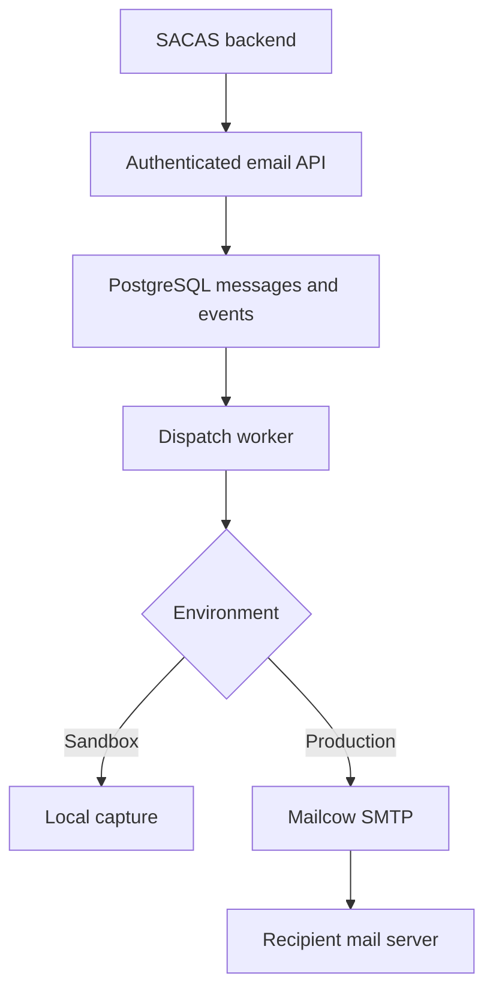

# Ditronics Mail — Four-Hour Implementation Plan

Date: 9 November 2026  
Purpose: Build the first working release of Ditronics' own transactional email platform on the existing Mailcow instance.  
First integration: SACAS.  
Status: Implementation specification; no server audit, code implementation, or deployment has been performed as part of this document.

## 1. Delivery commitment

Build a backend service that accepts authenticated email requests, durably queues them, renders approved templates, submits them to Mailcow, and exposes honest submission status. Connect SACAS to it for password resets, OTP delivery, and account notices.

Four hours is a timebox for a controlled internal release, not a guarantee of a complete SendGrid replacement. The full product remains the destination. Production rollout depends on the acceptance gates below, not the clock.

The estimate assumes one experienced implementer using coding assistance, access to the repositories and deployment environment, a working Mailcow SMTP account, and an available Laravel/PHP runtime. DNS propagation, blocked SMTP ports, new infrastructure procurement, or major SACAS refactoring can prevent completion in this window.

At hour four, the result must be one of:

- **Controlled release:** all mandatory gates pass; approved SACAS traffic can use the service.
- **Working staging build:** application works, but infrastructure or security gates remain unresolved; SACAS production stays on its current provider.
- **Blocked implementation:** report completed work, exact blocker, and remaining tasks. Never substitute mocks for a successful real-delivery claim.

## 2. Scope locked for the four-hour build

### Included

- One internal Ditronics organization; project and environment isolation in the schema.
- SACAS project with separate sandbox and production keys.
- CLI-based project/key provisioning, rotation, revocation, and sender configuration.
- Scoped API key authentication; approved sender and recipient policies.
- `POST /v1/emails`, `GET /v1/emails/{id}`, and basic health endpoints.
- PostgreSQL-backed durable dispatch with atomic message creation.
- Three versioned, code-owned templates: OTP, password reset, account notice.
- One recipient per message; HTML and plain-text alternatives.
- Verified TLS SMTP submission through existing Mailcow.
- Idempotency, bounded retries, expiry before submission, and uncertain-outcome handling.
- Metadata-only status and event history.
- Sandbox capture without external delivery.
- Per-project and per-recipient limits; manual suppression list.
- SACAS email adapter and controlled rollout flag.
- Deployment configuration, meaningful tests, and an operator runbook.

### Full-product work after this timebox

- Rich React dashboard, self-service onboarding, team roles and MFA UI.
- Editable template builder and template publishing workflow.
- Automatic domain provisioning and DNS verification interface.
- Postfix log collector, bounce ingestion, automated suppression, remote acceptance tracking.
- Signed outgoing webhooks and webhook replay dashboard.
- Advanced analytics, complaint feedback integrations, billing, and public customer access.
- High availability, multiple outbound servers, sophisticated routing, and provider failover.

These features are scheduled work, not implied capabilities of the first release. A small read-only status screen is optional only after all mandatory gates pass.

## 3. Architecture decisions for speed and correctness

| Area | Four-hour decision | Reason |
|---|---|---|
| Backend | Laravel modular application | Fits existing Ditronics experience and SACAS integration work |
| Database | PostgreSQL | Durable queue records and atomic conditional updates |
| Dispatch | Database-backed message work queue | Avoid an extra broker and dual-write problem in this timebox |
| Frontend | CLI and API first | Keep time for delivery reliability and tests |
| Templates | Versioned Blade files plus variable schemas | Avoid building an editor or executing customer-supplied templates |
| Transport | Laravel/Symfony SMTP transport to Mailcow | Reuse established SMTP and MIME handling |
| Deployment | Separate application stack; supervised worker | Isolate the application from Mailcow internals |
| Future scaling | Optional Redis dispatch acceleration | PostgreSQL remains the durable source of truth |

Pin dependencies through lockfiles and choose supported versions compatible with the actual server. Do not upgrade unrelated production services to satisfy an arbitrary framework version. Do not read or write Mailcow's internal database.



The API returns after the durable transaction commits. The worker claims queued messages from PostgreSQL. There is no requirement to enqueue into Redis to make a message discoverable.

## 4. Preflight inputs and hard blockers

Gather these through repository inspection and secure deployment configuration. Never paste passwords or API secrets into tickets, this document, or chat.

| Input | Needed for | If unavailable |
|---|---|---|
| SACAS repository and current mail integration | Provider adapter | Build service and documented integration contract; report SACAS as blocked |
| Runtime versions and deployment conventions | Compatible application skeleton | Use available supported tooling; record mismatch |
| SMTP hostname, port, username, secret | Mailcow submission | Run sandbox only |
| Approved sender address | Sender authorization | Do not invent or spoof a sender |
| API hostname and HTTPS route | Application connectivity | Test privately; no public release without HTTPS |
| PostgreSQL connection and backup location | Persistence | Prepare deployment but block live acceptance |
| Controlled test inboxes | Real delivery verification | No claim of real delivery |
| SACAS reset-link origin | URL validation | Reset template cannot be enabled |
| Mailcow operator/log access | Failure investigation | Keep pilot traffic small and identify operator handoff |

Audit Mailcow SMTP connectivity, TLS validation, sender authorization, outbound delivery, SPF/DKIM/DMARC results, reverse DNS, queue health, and available server resources. Record observations, not assumptions. Do not change staff mailbox routing or global Mailcow configuration as a shortcut.

## 5. Exact 240-minute execution schedule

| Elapsed time | Task | Required output / checkpoint |
|---|---|---|
| 00:00–00:20 | Inspect repos, runtime, SMTP and deployment inputs | Compatibility decision; blockers recorded; controlled SMTP test where configured |
| 00:20–00:45 | Scaffold service, migrations, config, project/key CLI | App starts; migration runs; SACAS sandbox key can be issued and revoked |
| 00:45–01:25 | Implement authentication, validation, send/status API, idempotency | Valid request durably queues; duplicate does not create a second message |
| 01:25–02:10 | Implement claim/dispatch worker, templates, SMTP and sandbox transports | Sandbox capture works; controlled real submission succeeds; failure states are honest |
| 02:10–02:40 | Integrate SACAS, rate limits, redaction, expiry and retention | SACAS authentication flow uses the adapter in staging |
| 02:40–03:20 | Run required API, worker and security tests | Evidence for release gates; fix failures before adding features |
| 03:20–03:45 | Deploy staging/controlled environment; verify restart and HTTPS | Health checks pass; persistent records survive restart; worker monitored |
| 03:45–04:00 | Exercise complete SACAS flow, assess release gate, write handoff | Release or staging decision; rollback instructions; remaining backlog |

If behind schedule, remove optional UI and presentation work first. Do not remove authentication, isolation, persistence, secret redaction, TLS verification, or required testing. Reserve the last 15 minutes for a truthful handoff even if deployment is blocked.

## 6. Concrete implementation tasks

### A. Application foundation

- [ ] Create the service in its own repository or designated application directory.
- [ ] Add `.env.example` with placeholders and ignore real environment files.
- [ ] Configure database, HTTP request limits, trusted proxy settings and HTTPS deployment.
- [ ] Create CLI commands to provision project/environment, approved sender, reset URL origins and initial API key.
- [ ] Store a lookup prefix and hash for each high-entropy key; show the secret once.
- [ ] Include scope, project, environment, expiry and revocation checks on every request.
- [ ] Do not expose public administrative write endpoints during this release.

### B. Suggested minimum schema

| Table | Important fields / constraints |
|---|---|
| `projects` | ID, name, enabled flag, quotas |
| `environments` | ID, project ID, sandbox/live mode, approved URL origins |
| `api_keys` | Prefix, secret hash, project/environment IDs, scopes, expires/revoked timestamps |
| `sender_identities` | Project/environment IDs, approved email and display-name policy |
| `messages` | UUID/ULID, project/environment IDs, key ID, recipient, template/version, encrypted payload, state, request HMAC, idempotency key, expiry, attempts, next attempt, lease token/expiry, SMTP acknowledgement metadata |
| `message_events` | Message ID, event type, timestamp, safe reason code; no secret content |
| `suppressions` | Project/environment IDs, recipient lookup, reason, created timestamp |
| `rate_limit_buckets` | Scoped key, window start, count; atomic increments |

Add a unique constraint on `(project_id, environment_id, idempotency_key)` and an index for eligible dispatch rows. Use ownership constraints where feasible. Queries always enforce project AND environment scope.

Use a keyed HMAC of the canonical validated request for idempotency comparison. A plain digest of an OTP-containing payload can expose a small code space to offline guessing. Keep the HMAC key and encryption key in secure configuration and preserve them for recovery.

### C. API contract

```http
POST /v1/emails
Authorization: Bearer <project-environment-key>
Idempotency-Key: <unique-application-event-id>
Content-Type: application/json
```

```json
{
  "from": "security@notify.example.com",
  "to": "controlled-recipient@example.com",
  "template": "password-reset",
  "template_version": 1,
  "variables": {
    "name": "Dadi",
    "reset_url": "https://sacas.example.com/reset?token=EXAMPLE",
    "expires_in_minutes": 15
  },
  "ttl_seconds": 300,
  "metadata": {
    "request_id": "reset-event-123"
  }
}
```

Example domains are placeholders. Provision real approved values before testing.

```json
{
  "id": "<message-id>",
  "status": "queued"
}
```

Return `202` only after durable commit. `GET /v1/emails/{id}` returns status, timestamps and safe events, never template variables or authentication secrets.

| Result | HTTP status |
|---|---|
| Accepted or identical idempotent replay | 202 with original message ID |
| Invalid/missing/revoked key | 401 |
| Missing scope or prohibited sender | 403 |
| Unknown or foreign message ID | 404 |
| Same idempotency key, different validated payload | 409 |
| Invalid template/variables/URL/TTL or suppressed recipient | 422 with safe reason code |
| Body too large | 413 |
| Rate/quota exceeded | 429 and Retry-After |
| Durable persistence unavailable | 503; do not claim acceptance |

Validate one recipient, approved sender, known template version, exact allowed variables, bounded strings, HTTPS reset origins, header injection, metadata restrictions and payload size. Resolve idempotent replays before charging a second send quota. Make quota reservation and message insertion atomic or release failed reservations deterministically.

### D. Templates and content

Create code-owned HTML and plain-text templates:

1. `otp.v1`: escaped name, code, validity text.
2. `password-reset.v1`: escaped name and approved reset URL.
3. `account-notice.v1`: escaped title/message; no arbitrary HTML or remote asset fetching.

Never evaluate user-provided Blade/PHP. Do not allow attachments, arbitrary headers, CC/BCC, arbitrary URLs, or raw HTML in this release. Pin template version on acceptance so a deployment does not silently change queued content.

### E. Dispatch and failure handling

Use atomic row claiming, e.g. a short transaction with row locks and `SKIP LOCKED`, to reserve an eligible message. Commit the claim before network I/O. Record an attempt and a lease token; updates must match the current token. Start with a single worker, but prevent duplicate claims by design.

| State | Meaning / next action |
|---|---|
| `queued` | Eligible for a worker when due |
| `submitting` | Worker owns an active lease and may be communicating with SMTP |
| `submitted` | Mailcow positively acknowledged acceptance; never automatically resubmit |
| `retry_wait` | Known temporary failure before acceptance; schedule bounded retry |
| `failed` | Known permanent submission failure |
| `unknown` | Acceptance may have happened; operator reconciliation required |
| `expired` | Deadline passed before new submission started |
| `captured` | Sandbox accepted locally; no external email was sent |

Set finite connection/SMTP timeouts and a lease longer than the enforced worker execution limit. Do not hold database locks while sending. If a worker dies after entering `submitting`, move the expired lease to `unknown` rather than blindly retrying. The same applies if SMTP accepted the message but persisting the acknowledgement failed.

Retry only failures proven to be safe before acceptance; use bounded backoff with jitter, for example approximately 15, 45 and 120 seconds, never beyond TTL. If the transport cannot reliably classify the failure, choose `unknown`. Generate a stable Message-ID for correlation, but do not treat it as recipient-side deduplication.

Mailcow owns onward delivery retries after `submitted`. Our service must not send another copy because the destination server deferred delivery. Do not label `submitted` as delivered, inboxed, or read.

TTL prevents stale submission by our worker. It cannot recall mail already accepted by Mailcow. SACAS must validate actual token expiry when the user attempts authentication.

### F. App integration

Every app, including the first one, uses the shared API-key contract in `docs/INTEGRATION.md`. There is no per-app adapter. The app calls `POST /v1/emails` from its backend with `Authorization: Bearer <key>` and one idempotency key per logical event.

## 7. Security and pilot operating defaults

Proposed defaults must be adjusted to observed traffic before wider release:

| Setting | Initial pilot policy |
|---|---|
| Recipients | One per request; real delivery initially restricted to approved test accounts |
| Message size | 32 KiB maximum request body |
| Project send limit | 30/minute and 500/day, configurable |
| Recipient send limit | 3/minute and 10/hour per project/environment |
| Authentication TTL | Default 300 seconds; maximum 900 seconds |
| Notice TTL | Default 1 hour; maximum 24 hours |
| Sensitive message content | Encrypt while needed; clear promptly on terminal outcome |
| Unknown-state content | Purge on a bounded policy no later than 24 hours; reconcile from metadata |
| Metadata retention | Proposed 30 days, documented and configurable |
| Content capture | Sandbox only, access restricted, automatic expiry |
| Production logs | Message ID, safe event code, timestamps; no bodies, variables, tokens, Authorization headers or SMTP passwords |

Retention deletion must run on a scheduled process and include captured payloads. Document that backups can retain older encrypted data until their own retention expires. Rate limits also apply at SACAS user/IP level to prevent recovery-email abuse. Fail closed for new sends if authoritative limit checks are unavailable.

No shared Mailcow admin credentials, TLS bypasses, open relay configuration, public database ports, or public arbitrary-recipient demo endpoints.

## 8. Deployment deliverables

Deliver these files in the implementation repository:

- `README.md`: installation, configuration, API usage and current limitations.
- `.env.example`: documented variables with placeholders only.
- Dependency lockfiles.
- Migrations, provisioning commands, template files and application code.
- Tests and exact commands for running them.
- `Dockerfile` and `compose.yaml`, if compatible with the existing deployment workflow.
- Reverse-proxy configuration for the selected hostname.
- Worker and retention/reconciliation scheduling configuration.
- `docs/openapi.yaml`: the implemented contract only.
- `docs/INTEGRATION.md`: the API-key contract every app uses.
- `docs/OPERATIONS.md`: restart, failure handling, key rotation, suppression, backups and rollback.
- `docs/RELEASE_REPORT.md`: passed/failed checks, actual real-delivery observations and remaining blockers.

Use one application image for API and worker roles. Use a multi-stage build; omit build tools and development dependencies from the runtime image where practical. Use explicit pinned image versions, health checks, persistent database storage, restart policies, restricted networks and resource limits based on the server audit. Keep Mailcow's existing Compose project separate.

`/health/live` only confirms process health. `/health/ready` checks critical local dependencies without exposing configuration. Monitor worker heartbeat separately; do not perform an SMTP connection for every health request. Record a database backup and protect encryption keys before live traffic. Do not claim disaster-recovery readiness without a restore test.

## 9. Mandatory acceptance tests

| Test | Passing evidence |
|---|---|
| Invalid and revoked key | Request denied; no message inserted |
| Project/environment isolation | Another project's key cannot read or send through foreign resources |
| Approved sender enforcement | Arbitrary sender rejected |
| Idempotency | Sequential and concurrent repeats produce one message ID and one submission attempt |
| Payload conflict | Same key with changed payload returns 409 |
| Database failure | No 202 when durable write fails |
| Worker interruption before claim | Queued message remains recoverable |
| Worker interruption during SMTP | Message becomes unknown; no automatic duplicate submission |
| Temporary known-safe failure | Bounded retry occurs and honors TTL |
| Expiry | Expired queued message never starts a new SMTP submission |
| Sandbox separation | Sandbox key captures locally without contacting real SMTP |
| Rate limiting | Limit enforced under concurrent requests |
| Secret handling | Logs/status API contain no OTPs, reset tokens or credentials |
| Template/URL validation | Unapproved URL, missing variable and injection attempt rejected |
| Manual suppression | Suppressed address cannot be queued |
| Real controlled delivery | Email arrives in designated inbox; headers checked; placement recorded |
| SACAS recovery | Fresh valid token works; expired/used token rejected |
| Restart | Database records persist and worker resumes safely |

Use a fake transport for deterministic failure tests and controlled real inboxes for integration tests. Passing one does not substitute for the other. Use sandbox transport for load checks; do not load-test real recipient providers.

## 10. Release and rollback gate

Release only when mandatory security/reliability tests pass, real controlled delivery works, the application is behind HTTPS, secrets are protected, and the operator can inspect Mailcow failures. Initially restrict real recipients to test accounts; expand to approved internal SACAS traffic after the gate.

Until bounce automation exists, an operator must review Mailcow delivery failures during the pilot and add confirmed invalid recipients to manual suppressions. Do not present this release as a public bulk-mail service. Do not expose delivered/bounced analytics that are not backed by real collected events.

Rollback procedure:

1. Pause new Ditronics Mail acceptance for the affected project or change SACAS routing for new requests.
2. Preserve queued, submitted and unknown message records.
3. Drain or explicitly cancel pending queued messages before rerouting their application events.
4. Never resend submitted/unknown requests through the old provider without reconciliation.
5. Restore the prior application image/configuration using backward-compatible migrations where possible.
6. Report affected IDs and outcomes without exposing authentication content.

## 11. Full-product development backlog

| Priority | Module | Dependency / completion condition |
|---|---|---|
| Next | Postfix log collector and bounce processor | Correlate queue IDs/Message-ID and recipient; ingestion survives restarts and duplicate events |
| Next | Automated suppression | Validated permanent-recipient failures; policy failures must not incorrectly suppress good addresses |
| Next | Signed webhooks | Stable event model; HMAC, replay protection, SSRF controls and retries |
| Next | Operational dashboard | Honest timelines, queue age, safe search, worker health and audit events |
| Next | Admin authentication and roles | Established identity/session mechanism; MFA and audit coverage |
| Later | Domain onboarding | Ownership challenge, DNS validation, sender permissions and safe provisioning |
| Later | Template editor/version publishing | Variable schema, preview isolation, immutable versions and rollback |
| Later | Analytics and provider feedback | Real delivery/complaint evidence; clear coverage limitations |
| Later | Scale and availability | Capacity measurements, outage targets, restore drills, isolated outbound reputation |
| Later | External customers and billing | Abuse operations, tenant security review, support and commercial requirements |

## 12. Implementation-agent instruction

> Implement this specification in the available repository. Begin with repository/runtime inspection and a concise blocker list. Work through the 240-minute schedule, producing executable code, migrations, tests, deployment configuration and integration documentation. Preserve existing SACAS authentication logic and Mailcow operations. Use secure configuration for credentials. Keep all message-status claims consistent with actual evidence. Complete mandatory gates before spending time on optional UI. When dependencies are missing, continue independent work and clearly label simulated versus real results. Finish with changed files, exact setup/test commands, test outcomes, deployment status, rollback steps, and the remaining full-product backlog. Do not claim the service is deployed or production-ready unless those outcomes were actually verified.

## 13. Technical references

These references informed the architecture discussion; verify implementation details against the installed versions before making infrastructure changes.

- Mailcow client configuration: https://docs.mailcow.email/client/client-manual/
- Mailcow system requirements and ports: https://docs.mailcow.email/getstarted/prerequisite-system/
- Mailcow relayhosts: https://docs.mailcow.email/u_e-postfix-relayhost/
- Postfix delivery-status notifications: https://www.postfix.org/DSN_README.html
- Postfix logging/debugging: https://www.postfix.org/DEBUG_README.html
- Gmail sender requirements: https://support.google.com/mail/answer/81126
- OWASP password-reset guidance: https://cheatsheetseries.owasp.org/cheatsheets/Forgot_Password_Cheat_Sheet.html

## 14. Hour-four handoff checklist

- [ ] Working source and lockfiles committed in the implementation repository.
- [ ] Service setup and deployment commands documented.
- [ ] SACAS integration completed or exact blocker recorded.
- [ ] API key provisioned securely; no secret included in the handoff.
- [ ] Mandatory tests listed with actual pass/fail results.
- [ ] Controlled delivery outcome recorded accurately.
- [ ] Worker supervision and retention scheduling configured.
- [ ] Production/staging/blocked status explicitly stated.
- [ ] Rollback and unknown-outcome reconciliation documented.
- [ ] Remaining modules listed without suggesting they already exist.
