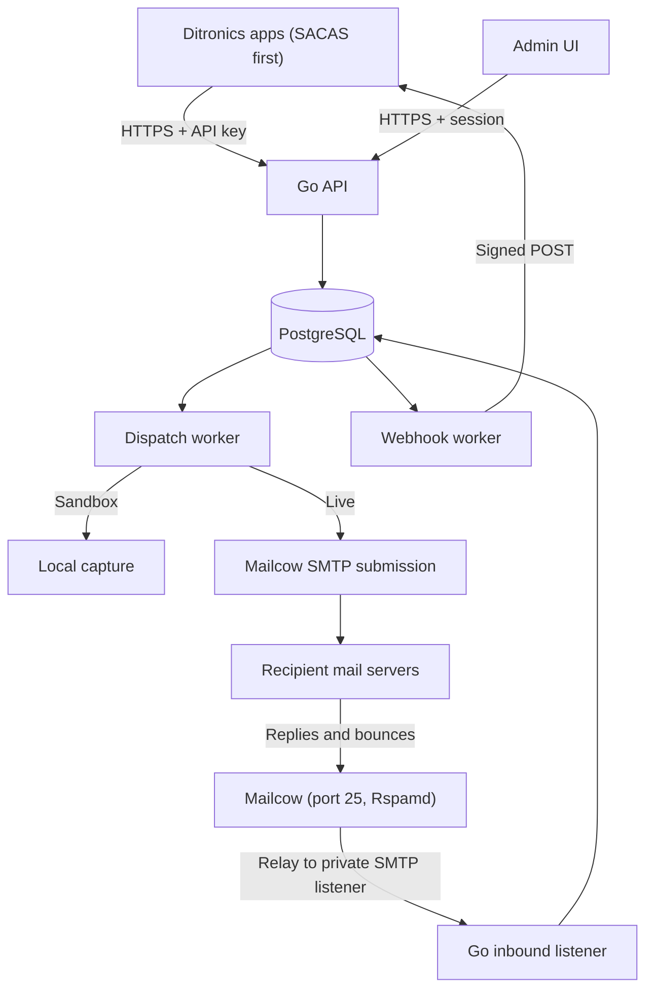

# Ditronics Mail v2 — Full Implementation Plan (Go backend + UI)

Date: 9 November 2026
Replaces: `DITRONICS_MAIL_4_HOUR_IMPLEMENTATION_PLAN.md` (Laravel, outbound only)
Goal: our own internal email platform — outbound sending, inbound receiving, bounces, webhooks and an admin UI — running on our existing Mailcow, with no paid provider.
First integration: SACAS (Go/Gin backend).
Status: specification only. The Go backend is partly built; this plan has not been checked against that code yet (see Phase 0).

---

## 1. What we are building

One internal service that every Ditronics app calls for email.

| Capability | In this plan | Notes |
|---|---|---|
| Send API with scoped API keys | Yes | Core |
| Durable queue, retries, idempotency | Yes | PostgreSQL is the queue |
| Sandbox capture | Yes | No external delivery |
| Templates in English and Kiswahili | Yes | Versioned, stored in the database |
| Inbound email parsed to JSON | Yes | New |
| Bounce processing and automatic suppression | Yes | New |
| Signed webhooks with retries and replay | Yes | New |
| DNS health check (SPF, DKIM, DMARC, MX, PTR) | Yes | Read-only checker, no auto-provisioning |
| Admin UI | Yes | Built on the frontend template already in the repo |
| Wallet, billing, public signup | No | We are the only customer |
| SMS on receive, AI auto-reply | No | Not needed for internal use |
| Marketing or bulk campaigns | No | Transactional only; protects IP reputation |

Rules carried over from v1 and not negotiable:

- Never report a status we cannot prove. `submitted` means Mailcow accepted the message, nothing more. `delivered` is never shown; the strongest positive state is `submitted` with no bounce received.
- Never auto-retry when acceptance is uncertain. Use `unknown` and let an operator reconcile.
- Never log or return OTPs, reset tokens, message bodies, API keys or SMTP passwords.
- Never read or write Mailcow's internal database.
- Every query is scoped by project AND environment.

---

## 2. Architecture

| Area | Decision | Reason |
|---|---|---|
| Language | Go, single binary with roles: `api`, `worker`, `inbound`, `scheduler` | Matches the code already written and the SACAS stack |
| HTTP router | Keep whatever the existing code uses | No rewrite for taste |
| Database | PostgreSQL via `pgx`; SQL migrations | Durable queue with `FOR UPDATE SKIP LOCKED` |
| Queue | Database tables, no Redis or broker | No dual-write problem |
| Outbound | SMTP submission to Mailcow over verified TLS | Mailcow does DKIM signing and onward retries |
| Inbound | Mailcow relays a dedicated subdomain to a private Go SMTP listener | Mailcow keeps port 25, TLS and spam filtering |
| Inbound fallback | IMAP polling of a catch-all mailbox | Use only if relay routing cannot be configured |
| Bounces | Parse DSN emails that return to our bounce address | Needs no access to Postfix logs |
| Templates | Go `html/template` and `text/template`, stored in DB with immutable versions | Auto-escaping; no user code execution |
| Admin auth | Email + password (argon2id), server-side sessions, roles | Simple and auditable |
| Frontend | The template already added to the repo | Do not change the UI kit |
| Deployment | Own Compose project, separate from Mailcow | Isolation |

Mail domains (replace with the real ones during setup):

- `notify.<domain>` — sending domain for outbound mail.
- `bounces@notify.<domain>` — envelope sender; DSNs come back here.
- `in.<domain>` — inbound subdomain; every address under it is routed to the Go listener.

If DNS is managed on Cloudflare, every mail hostname (MX target, SMTP host) must be DNS-only, not proxied. Cloudflare's proxy does not carry SMTP.

---

## 3. Phase 0 — Audit what already exists (do this first)

The backend is about half built. Before writing new code, compare the repository against this table and record each row as **Done**, **Partial** or **Missing** in `docs/AUDIT.md`. Fix Partial items before starting new modules.

| Item | What "Done" means |
|---|---|
| Projects and environments | Tables exist; sandbox/live mode; queries scoped |
| API keys | Prefix + hash stored; scopes; expiry; revocation; secret shown once |
| `POST /v1/emails` | Returns 202 only after commit; validation complete |
| Idempotency | Unique on `(project, environment, key)`; HMAC payload comparison; 409 on mismatch |
| Dispatch worker | `SKIP LOCKED` claim, lease token, claim committed before SMTP |
| State machine | All states in section 5 implemented, including `unknown` |
| SMTP transport | TLS verified; finite timeouts; failure classification |
| Sandbox transport | Captures locally; never dials SMTP |
| Rate limits | Per project and per recipient; atomic under concurrency |
| Suppressions | Checked at accept time |
| Payload encryption | Encrypted at rest; cleared on terminal state |
| Tests | Exist and pass for the above |

---

## 4. Database schema

Existing tables (confirm in Phase 0): `projects`, `environments`, `api_keys`, `sender_identities`, `messages`, `message_events`, `suppressions`, `rate_limit_buckets`.

New tables:

| Table | Important fields |
|---|---|
| `users` | ID, email, password hash (argon2id), role (`owner`, `admin`), disabled flag, last login |
| `sessions` | Token hash, user ID, expiry, IP, user agent |
| `audit_log` | User ID or API key ID, action, target type and ID, timestamp, safe details |
| `templates` | ID, project ID, slug, description, archived flag |
| `template_versions` | Template ID, version number, locale (`en`, `sw`), subject, HTML body, text body, variable schema (JSON), published timestamp; immutable once published |
| `inbound_addresses` | Project/environment IDs, local part or wildcard, enabled flag, webhook endpoint ID (optional) |
| `inbound_messages` | ID, address ID, envelope from/to, header from, subject, text body, HTML body, parsed headers (JSON), spam score, raw size, received timestamp, retention expiry |
| `inbound_attachments` | Inbound message ID, filename, content type, size, storage path, SHA-256 |
| `bounces` | Message ID (nullable if uncorrelated), recipient, type (`hard`, `soft`, `policy`, `unknown`), SMTP status code, diagnostic text (truncated), received timestamp |
| `webhook_endpoints` | Project/environment IDs, URL, signing secret (encrypted), subscribed event types, enabled flag |
| `webhook_deliveries` | Endpoint ID, event type, payload (JSON), state, attempts, next attempt, lease token/expiry, last response code |
| `dns_checks` | Domain, record type, expected value, observed value, pass/fail, checked timestamp |
| `worker_heartbeats` | Role, instance ID, last seen |

Changes to `messages`: add `locale`, `template_version_id`, `bounce_state` (`none`, `soft`, `hard`), `smtp_message_id`.

Changes to `suppressions`: add `source` (`manual`, `hard_bounce`) and `bounce_id`.

---

## 5. Backend modules

### 5.1 Outbound (finish and harden)

Message states:

| State | Meaning |
|---|---|
| `queued` | Waiting for a worker |
| `submitting` | A worker holds the lease and may be talking to SMTP |
| `submitted` | Mailcow acknowledged acceptance; never resubmit |
| `retry_wait` | Known temporary failure before acceptance; bounded retry |
| `failed` | Known permanent submission failure |
| `unknown` | Acceptance may have happened; operator must reconcile |
| `expired` | TTL passed before submission started |
| `captured` | Sandbox only; nothing left the server |

- [ ] Retry backoff of about 15, 45 and 120 seconds with jitter, never past TTL.
- [ ] An expired lease in `submitting` moves to `unknown`, not back to `queued`.
- [ ] Add headers on every message: stable `Message-ID`, `X-DM-Message-ID` (our ID), `Auto-Submitted: auto-generated`.
- [ ] Envelope sender is the bounce address; header `From` is the approved sender.
- [ ] Accept `locale` (`en` or `sw`, default `en`) and pin the template version at accept time.
- [ ] Emit events to the webhook outbox in the same transaction as each state change.

### 5.2 Templates

- [ ] CRUD for templates and draft versions; publishing makes a version immutable.
- [ ] Each version holds `en` and `sw` content; missing locale falls back to `en`.
- [ ] Variable schema lists allowed names, types and maximum lengths; unknown variables are rejected at send time.
- [ ] Render with `html/template` (HTML) and `text/template` (plain text). No custom functions that touch files, network or environment.
- [ ] Preview endpoint renders with sample variables and returns HTML and text; never sends.
- [ ] Test-send endpoint works in sandbox for anyone, in live only to approved test addresses.
- [ ] Seed three templates: `otp`, `password-reset`, `account-notice`, in both languages.
- [ ] URL variables must match the environment's approved origins.

### 5.3 Inbound email

Mailcow setup (operator task, documented in `docs/MAILCOW_SETUP.md`):

1. Add `in.<domain>` as a relay domain in Mailcow.
2. Add a transport map sending that domain to the Go listener on the private Docker network.
3. Publish the MX record for `in.<domain>` pointing at the Mailcow host.
4. Verify the exact steps against the installed Mailcow version before changing anything.

Go listener:

- [ ] SMTP server (for example `emersion/go-smtp`) bound to the private network only; never exposed publicly.
- [ ] Accept mail only from the Mailcow host address; reject others.
- [ ] Limits: 10 MiB per message, 10 attachments, 20 recipients; reject above them with a permanent SMTP error.
- [ ] Reject unknown recipients at `RCPT TO` so Mailcow bounces them instead of us storing junk.
- [ ] Store the raw message to disk first, then return `250`; parse asynchronously so a parser crash cannot lose mail.
- [ ] Parse MIME (for example `jhillyerd/enmime`) into text, HTML, headers and attachments.
- [ ] Record the spam score header that Rspamd adds.
- [ ] Never render inbound HTML unsanitised; the UI shows it in a sandboxed frame with remote content blocked.
- [ ] Store attachments outside the web root with generated names; serve with `Content-Disposition: attachment`.
- [ ] Emit an `inbound.received` event to the webhook outbox.
- [ ] Retention job deletes inbound bodies and attachments after the configured period (proposed 30 days).

### 5.4 Bounce processing and automatic suppression

- [ ] Mail to `bounces@notify.<domain>` is routed to the same inbound listener and handled by a bounce handler instead of being stored as normal inbound mail.
- [ ] Parse `multipart/report` DSNs (RFC 3464): recipient, action, status code, diagnostic.
- [ ] Correlate to our message using `X-DM-Message-ID` or `Message-ID` in the returned headers.
- [ ] Classify:

| Status | Type | Action |
|---|---|---|
| `5.1.x` (bad mailbox or domain) | `hard` | Suppress recipient; set `bounce_state = hard` |
| `4.x.x` | `soft` | Record only; Mailcow keeps retrying |
| `5.7.x` (policy, blocked, authentication) | `policy` | Record and raise an alert; do NOT suppress |
| Anything unparseable | `unknown` | Record raw summary for operator review |

- [ ] Policy bounces must never suppress an address: they mean our reputation or DNS is wrong, not the recipient.
- [ ] Bounce handling is idempotent; the same DSN processed twice creates one bounce row.
- [ ] Emit `email.bounced` to the webhook outbox.
- [ ] Alert when the hard-bounce or policy-bounce rate over the last hour passes a threshold.

### 5.5 Webhooks

- [ ] Event types: `email.submitted`, `email.failed`, `email.unknown`, `email.expired`, `email.bounced`, `inbound.received`.
- [ ] Outbox pattern: the delivery row is written in the same transaction as the event.
- [ ] Sign each request: header `X-DM-Signature: t=<unix>,v1=<hex HMAC-SHA256 of "t.body">`. Document verification and a five-minute tolerance.
- [ ] Each delivery has a unique event ID so receivers can deduplicate.
- [ ] Retries with backoff over about 24 hours, then `dead`; manual replay from the UI.
- [ ] SSRF controls: HTTPS only, resolve the host and refuse private, loopback and link-local addresses, no redirects, 10-second timeout, 1 MiB response cap.
- [ ] Payloads contain IDs, states and safe reason codes only; no bodies, variables or tokens. Receivers fetch inbound content through the API.
- [ ] Disable an endpoint automatically after repeated consecutive failures and show that in the UI.

### 5.6 DNS health checker

- [ ] For each sending and inbound domain, check SPF, the DKIM selector Mailcow uses, DMARC, MX and reverse DNS of the outbound IP.
- [ ] Store results in `dns_checks`; run on demand and daily.
- [ ] Read-only. The UI shows the expected record and the observed one; the operator fixes DNS by hand.

### 5.7 Admin authentication and audit

- [ ] First owner account is created by CLI, not by a public endpoint. No signup page.
- [ ] Passwords hashed with argon2id; login rate-limited per account and per IP.
- [ ] Sessions in HttpOnly, Secure, SameSite=Lax cookies; CSRF token on every state-changing request.
- [ ] Roles: `owner` (everything, including user management) and `admin` (everything except users). Both can read the console.
- [ ] Every write from the UI or CLI goes to `audit_log`.
- [ ] TOTP second factor is a follow-up, not a blocker for internal launch behind HTTPS.

### 5.8 Operations

- [ ] `/health/live`, `/health/ready`, worker heartbeats.
- [ ] Metrics endpoint: queue depth, oldest queued age, sends per state, bounce counts, webhook backlog.
- [ ] Scheduler role: retention, lease recovery, DNS checks, bounce-rate alerts.
- [ ] Structured logs with message ID and safe codes only.

---

## 6. API surface

Application API (API key, header `Authorization: Bearer <key>`):

| Method and path | Purpose |
|---|---|
| `POST /v1/emails` | Queue an email (existing) |
| `GET /v1/emails/{id}` | Status and safe events (existing) |
| `GET /v1/inbound` | List inbound messages for the key's environment |
| `GET /v1/inbound/{id}` | One parsed inbound message |
| `GET /v1/inbound/{id}/attachments/{aid}` | Download an attachment |
| `GET /v1/suppressions` / `POST` / `DELETE` | Manage suppressions (scope required) |

Admin API (session cookie, prefix `/admin/v1`):

| Group | Endpoints |
|---|---|
| Auth | login, logout, current user |
| Overview | counters, queue age, bounce rate, worker health |
| Messages | list with filters, detail with timeline, mark `unknown` as resolved |
| Inbound | list, detail, attachments, addresses CRUD |
| Projects | projects and environments CRUD, limits, approved origins |
| API keys | create (secret returned once), rotate, revoke |
| Senders and DNS | sender identities CRUD, run DNS check, view results |
| Templates | CRUD, draft, publish, preview, test-send |
| Webhooks | endpoints CRUD, deliveries list, replay, rotate secret |
| Suppressions | list, add, remove with reason |
| Sandbox | captured messages list and detail |
| Users and audit | users CRUD (owner only), audit log |

Document only what is implemented in `docs/openapi.yaml`.

---

## 7. UI implementation

Build on the frontend template already in the repo. Reuse its layout, tables, forms and charts; do not add a second UI kit.

| Page | What it shows and does |
|---|---|
| Login | Email and password; generic error message |
| Overview | Sent today, queue depth, oldest queued age, counts by state, hard and policy bounce rate, worker heartbeats, DNS status badge |
| Messages | Table with filters (project, environment, state, template, recipient, date). Detail page: timeline of events, attempts, bounce info. Never shows variables or body |
| Unknown queue | Messages in `unknown` with a "mark resolved" action and a required note |
| Inbound | Inbox-style list; detail with text view by default, sandboxed HTML view, headers, attachments download |
| Inbound addresses | Create and disable addresses under `in.<domain>`; link to a webhook endpoint |
| Projects | Projects and their sandbox/live environments, limits, approved URL origins |
| API keys | List with prefix, scopes, last used, expiry. Create dialog shows the secret once with a copy button and a warning |
| Senders and DNS | Sender identities; per-domain table of expected vs observed records with pass/fail and a "check now" button |
| Templates | List; editor with tabs for EN and SW, subject, HTML, text and variable schema; live preview pane with sample variables; version history; publish and test-send buttons |
| Webhooks | Endpoints with event subscriptions and status; deliveries table with response codes; replay button; secret rotation |
| Suppressions | Table with source (manual or hard bounce), reason and date; add and remove |
| Sandbox | Captured messages with rendered preview, restricted to `admin` and `owner` |
| Users | Owner only: invite, change role, disable |
| Audit log | Who did what and when, with filters |
| Settings | Retention periods, rate-limit defaults, alert thresholds |

UI rules:

- [ ] Status labels use the exact backend states. No "Delivered" label anywhere.
- [ ] Every destructive action (revoke key, delete address, remove suppression) asks for confirmation.
- [ ] Hide actions the user's role cannot perform; the backend still enforces them.
- [ ] All tables are server-paginated; no page loads the full message history.
- [ ] Loading, empty and error states on every page.
- [ ] Inbound HTML is rendered only inside a sandboxed iframe with scripts and remote content disabled.
- [ ] Times shown in Africa/Dar_es_Salaam with the UTC value on hover.

---

## 8. App integration

Every app uses the same `/v1` contract and its own API key. There is no per-app adapter. The contract is [docs/INTEGRATION.md](docs/INTEGRATION.md).

---

## 9. Build order

Sizes are rough estimates for one developer with a coding agent; adjust after Phase 0.

| Phase | Work | Rough size | Exit check |
|---|---|---|---|
| 0 | Audit existing code against section 3 | 1–2 hours | `docs/AUDIT.md` complete |
| 1 | Finish and harden outbound (5.1), tests | Half a day to 1 day | Real controlled delivery to a test inbox; all outbound tests pass |
| 2 | Admin auth, audit, core UI: Login, Overview, Messages, Projects, API keys, Suppressions, Sandbox | 1–2 days | An admin can do everything the CLI did |
| 3 | Templates in DB with EN/SW, editor and preview UI | 1 day | Publish a version, send it in both languages |
| 4 | Shared API-key integration for every app | Half a day | An app queues mail with its own key; see docs/INTEGRATION.md |
| 5 | Inbound listener, parser, API, Inbound UI | 1–2 days | Mail to `in.<domain>` appears parsed in the UI |
| 6 | Bounce handler, auto-suppression, alerts | 1 day | Send to a known-bad address; it is suppressed automatically |
| 7 | Webhooks with UI and replay | 1 day | Signed event received and verified by a test receiver |
| 8 | DNS checker, metrics, retention, runbook | Half a day | DNS page all green; restore test done |

Phases 1 to 4 give a usable internal sender. Phases 5 to 7 give full independence.

If time is short, cut UI polish and optional pages (Settings, Audit log view) first. Never cut authentication, scoping, redaction, TLS verification or tests.

---

## 10. Acceptance tests

Outbound (from v1, all still required):

| Test | Passing evidence |
|---|---|
| Invalid or revoked key | Denied; nothing inserted |
| Project/environment isolation | A key cannot read or send through another project's resources |
| Idempotency | Concurrent repeats give one message and one submission |
| Payload conflict | Same key, different payload returns 409 |
| Worker killed during SMTP | Message becomes `unknown`; no duplicate |
| Expiry | Expired message never starts submission |
| Sandbox | Never contacts real SMTP |
| Rate limiting | Holds under concurrent requests |
| Secret handling | No OTPs, tokens or credentials in logs, API or UI |
| Real controlled delivery | Arrives; SPF, DKIM and DMARC pass in the headers |

New:

| Test | Passing evidence |
|---|---|
| Locale | `sw` request renders the Swahili version; missing locale falls back to `en` |
| Template immutability | A published version cannot be edited; queued mail keeps its pinned version |
| Template injection | Variables containing HTML or template syntax are escaped |
| Inbound happy path | Message with attachment is parsed and readable via API and UI |
| Inbound limits | Oversized message and unknown recipient are rejected at SMTP |
| Inbound source restriction | Connection from a non-Mailcow address is refused |
| Inbound XSS | Malicious HTML email cannot run script in the UI |
| Hard bounce | DSN for a bad address creates a bounce, suppresses the recipient, fires a webhook |
| Policy bounce | `5.7.x` DSN raises an alert and does not suppress |
| Duplicate DSN | Processed twice, one bounce row |
| Webhook signature | Receiver verifies; tampered body fails |
| Webhook retry and replay | Failing endpoint retried with backoff; replay works from the UI |
| Webhook SSRF | Private, loopback and redirecting URLs are refused |
| Admin roles | Viewer cannot write or read inbound bodies; enforced by the backend |
| CSRF | State-changing admin request without token is rejected |
| Login throttling | Repeated bad passwords are rate-limited |
| Restart | All workers resume safely; no lost or duplicated work |

---

## 11. Deliverability checklist (operator)

The software cannot fix these; do them before live traffic.

- [ ] SPF record for `notify.<domain>` authorises the Mailcow IP.
- [ ] DKIM key generated in Mailcow for `notify.<domain>` and published.
- [ ] DMARC record published; start at `p=none`, move to `quarantine` once reports look clean.
- [ ] Reverse DNS of the outbound IP matches the Mailcow hostname.
- [ ] Outbound port 25 is open from the server.
- [ ] The IP is not on major blocklists.
- [ ] Mailcow mailbox used for submission is allowed to send as the approved sender addresses.
- [ ] Warm up: start with internal test accounts, then SACAS staff, then all SACAS users.
- [ ] Keep sending transactional mail only from this domain.

---

## 12. Deliverables

- Go source, migrations and lockfile (`go.sum`).
- `Dockerfile` (multi-stage) and `compose.yaml` with roles `api`, `worker`, `inbound`, `scheduler`.
- Frontend source built on the existing template.
- `.env.example` with placeholders only.
- `docs/AUDIT.md`, `docs/openapi.yaml`, `docs/MAILCOW_SETUP.md`, `docs/INTEGRATION.md`, `docs/WEBHOOKS.md`, `docs/OPERATIONS.md`, `docs/RELEASE_REPORT.md`.
- Tests with the exact commands to run them.

---

## 13. Implementation-agent instruction

> Implement this specification in the existing Go repository. Start with Phase 0: inspect the code, write `docs/AUDIT.md` marking each item Done, Partial or Missing, and list blockers. Then follow the build order in section 9, finishing each phase's exit check before starting the next. Keep the existing router, project layout and frontend template; do not rewrite working code for style. Write tests alongside each module. Use secure configuration for all credentials and never print secrets. Keep every status claim consistent with real evidence, and label simulated results as simulated. Do not change Mailcow configuration or DNS yourself; write the exact steps into `docs/MAILCOW_SETUP.md` for the operator. End each phase with a short report: files changed, commands to run, test results, and what remains.
